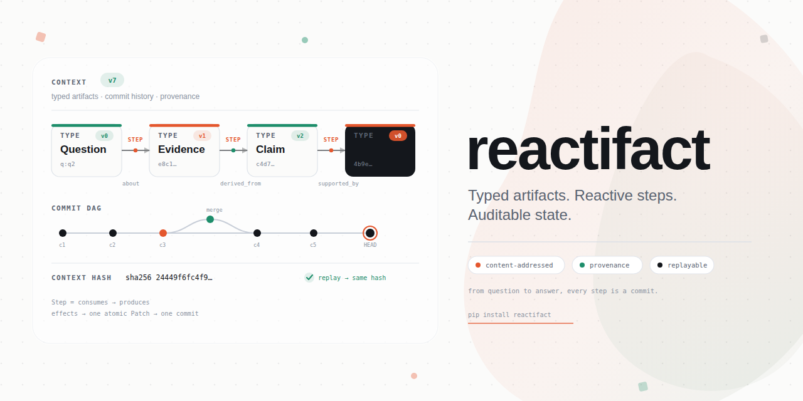
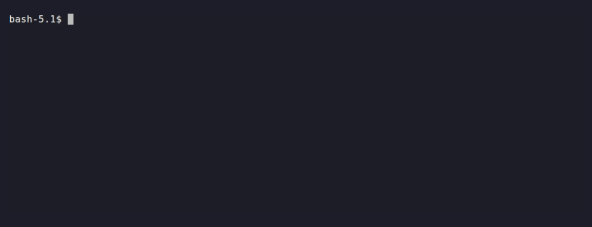

<p align="center">
  
</p>

**Auditable agents for Python.** Build **knowledge assistants** over docs, spreadsheets and the web — where the path per question isn't a graph you can draw. Every answer is computed, versioned and reproducible — not a string you have to trust.

[](https://github.com/bzdvdn/reactifact/actions/workflows/ci.yml)
[](https://codecov.io/gh/bzdvdn/reactifact)
[](https://github.com/bzdvdn/reactifact)
[](https://pypi.org/project/reactifact/)
[](LICENSE)
[](https://deepwiki.com/bzdvdn/reactifact)
[](https://bzdvdn.github.io/reactifact/)

> **Is:** a Python library (3 core deps) · single-process · typed, versioned artifacts with provenance · deterministic replay · runs offline, no API key
> **Isn't:** a managed platform · a distributed task queue · a pre-built agent/tool marketplace

A question like *"why did infra costs jump in Q2?"* needs a spreadsheet, a policy doc and a page off the web — and the *next* question needs a different subset. That is not one graph you can draw up front. You declare what artifacts exist and what agents can do with them; the runtime derives the order — and the dependency graph — from state. You don't draw the graph.

Every derived artifact then links to what produced it
(`Answer —supported_by→ Evidence —extracted_from→ Doc`), so *"why did it say
that?"* is a query, not a guess — and the run is reproducible (`context_hash`)
and verifiable (`reactifact replay --verify`).

## On top: a provable answer

[`examples/fintech_audit`](examples/fintech_audit) — a transactions CSV, a budget
CSV and a policy doc, **no API key**. The model never produces the number; plain
Python does, and the answer is linked to its evidence:

```text
$ .venv/bin/python -m examples.fintech_audit.main

  cloud spend:        $45,000   (2026-04 $12k, 2026-05 $15k, 2026-06 $18k)
  variance vs budget: +12.5%    budget $40,000, policy threshold 10% → over

  answer:    Q2 cloud spend was $45,000 against a $40,000 budget (+12.5%) —
             exceeds the 10% policy threshold. CFO approval is required.
  citations: budget.csv, transactions.csv, policy.md
  audit:     Answer —supported_by→ {Variance, Spend, Table, Policy}
             answer sha256 5461290d…  ·  context sha256 24449f6f…

  >>> re-running the pipeline hashes identically — or verify a saved run:
  >>> reactifact replay <store> --session <id> --verify 24449f6f…
```

That hash is the whole point: the answer is *reproducible* and its provenance is
a queryable graph (`context.related(answer.id, "supported_by")`), not a log line.



The number is computed, and its provenance recorded, in plain Python — the model
is never the source of truth (trimmed from
[`examples/fintech_audit/steps.py`](examples/fintech_audit/steps.py)):

```python
@step(produces=Variance, consumes=Spend)         # wakes when a Spend artifact exists
async def compute_variance(call: StepCall) -> None:
    spend = call.trigger                         # the artifact that triggered this run
    budget = cloud_budget(call.context)          # read from budget.csv
    pct = (spend.data.total - budget) / budget   # deterministic — never the model
    variance = call.effects.create_once_from(
        spend,                                   # stable id → idempotent re-runs (§42)
        Variance(actual=spend.data.total, budget=budget, pct=pct,
                 threshold=0.10, within_policy=abs(pct) <= 0.10),
    )
    variance.link("calculated_from", spend)      # provenance edge, queryable


answer = ctx.latest(AuditAnswer)
print(report_to_markdown(build_report(ctx, answer)))  # hash per artifact + edges
print(context_hash(ctx))                              # reproducible fingerprint
```

## Knowledge assistants, live

The same shape over many sources, not a fixed path — the
[`knowledge`](examples/knowledge) CLI answers a harder, multi-source question
(docs + a CSV) with a real computed number and its sources, no LLM key required:


Two agents explore independently on their own forks and merge back automatically
— and when they disagree, reactifact refuses to merge silently:


<details>
<summary><strong>If you know Celery…</strong> — the programming model, not its distributed runtime</summary>

Python developers already know this model from Celery: define a **task**,
declare what triggers it, let the runtime run it. reactifact applies it to
agents — a task reacts to a **typed, versioned artifact** appearing in the
context, not to a queue message you push or a graph edge you draw. The runtime
derives what runs next from state.

| Celery | reactifact |
| --- | --- |
| a task | `Step` / `@step(produces=Model, consumes=Input)` — a unit of work that writes an artifact |
| `delay()` / `apply_async()` | you don't call it: creating the input artifact **is** the trigger |
| routing key / queue | `Consume(Type)` — which artifact type wakes the task |
| chain / group / chord | several step `Consume`s / `produces`; the runtime derives the order |
| result backend | the `Context` — typed, versioned artifacts |
| worker | `Runtime` |

**Not inherited:** a broker, a worker pool, `acks_late`/redelivery, cross-process
exactly-once. reactifact is a library with an in-process runtime — the *model* is
Celery-shaped, the deployment is not. (Session-backed runs do survive a restart;
see [Durability & resume](docs/en/durability.md).)

</details>

```bash
pip install reactifact
```

Runs offline, no API key needed — paste this straight into a `.py` file. Two
agents, no graph edge declared between them — the second reacts because the
first one's output exists, and the answer carries *proof* of where it came
from:

```python
from pydantic import BaseModel

from reactifact import Budget, Context, Runtime, RuntimeResources, create_agent, step


class Question(BaseModel):
    text: str


class Evidence(BaseModel):
    text: str


class Answer(BaseModel):
    text: str


DOCS = {
    "refund": "Refunds are available within 14 days of purchase.",
    "pricing": "The Pro plan is $49/month, billed annually.",
}


@step(produces=Evidence, consumes=Question)
async def find_evidence(call):
    question = call.trigger
    hit = next((v for k, v in DOCS.items() if k in question.data.text.lower()), None)
    if hit is not None:
        call.effects.create(Evidence(text=hit))


@step(produces=Answer, consumes=Evidence)
async def answer_from_evidence(call):
    evidence = call.trigger
    call.effects.create(Answer(text=evidence.data.text)).link("supported_by", evidence)


search_agent = create_agent("search", steps=[find_evidence])
answer_agent = create_agent("answer", steps=[answer_from_evidence])

ctx = Context(resources=RuntimeResources())
runtime = Runtime(ctx, agents=[search_agent, answer_agent], budget=Budget(max_runs=10))

ctx.create(Question(text="what's your refund policy?"))
runtime.run()  # search_agent and answer_agent both react — nobody wired them together

answer = ctx.latest(Answer)
evidence = ctx.related(answer.id, "supported_by")[0]
print(answer.data.text)                     # "Refunds are available within 14 days of purchase."
print("supported_by:", evidence.data.text)  # provenance you can trace, not just a string in a log
```

## How it works

```text
ARTIFACT CREATED / UPDATED
       │
       ▼
     AGENTS REACT ──effects──► Effects ──compile──► Patch
       ▲                                                      │
       └──────────────────────────────────────────────────────┘
                                                        Context v+1
```

A step writes what should change (`effects.create/update/link/ask`) and
returns `None`; the runtime compiles the effect set into one **atomic** `Patch`
and moves the context to the next version. The `event` that wakes an agent is
*derived* from that same change — the causal chain can never drift from the
actual state.

## What makes it different

| Traditional agent (LangGraph / CrewAI / LangChain) | reactifact |
| --- | --- |
| A program follows a graph / plan | Agents **react** to state changes |
| Messages are strings | **Typed, versioned artifacts** (`Claim`, `Evidence`, `Answer`) |
| Orchestration is explicit wiring | Orchestration **falls out of the state** |
| A unit of work *returns* a change | An agent **writes effects**; the runtime compiles them |
| Retries/rollback are manual | Context is **git-like versioned** (diff, rollback, branch, merge) |
| "Who produced this?" is lost | **Provenance** links every derived artifact to its inputs |
| The model guesses the numbers | **Calculations are calculated** — the LLM is a reasoning component, not the source of truth |
| Tracing needs a SaaS add-on | **Native trace store** (SQLite + dashboard), exportable to Langfuse/Postgres |
| MCP via a framework adapter | **MCP both ways** built in — call any server, or expose your own `Context` as one |
| Pulls in a framework's dependency tree | **3 core deps**: `pydantic`, `httpx`, `python-dotenv` |

Reactive. Deterministic. Accountable.

Full breakdown, including where reactifact is *not* the right choice:
[docs/en/comparison.md](docs/en/comparison.md).

## Core primitives

- **Context** — versioned working state, git-like commits, `diff`/`rollback`/`merge`.
- **Artifact** — a first-class typed object (`Claim`, `Evidence`, `Answer`), not a string blob.
- **Effects** — an agent states its change via `effects.create/update/link/ask`; the runtime compiles it.
- **Patch** — the compiled, validated change-set applied as one atomic commit.
- **Step** — the unit of work: declares `consumes`/`produces`, returns its output or writes effects.
- **Agent** — a thin container of `steps`; the runtime derives triggers from their `consume` contracts.
- **Source** — retrieval is a capability: vector search is *one* strategy, not the only one; filesystem, CSV, and the web are equally first-class today (direct API, keyword, and SQL sources are on the [roadmap](docs/roadmap.md#next), not yet shipped).
- **Provenance** — every derived artifact links to what produced it
  (`Answer —supported_by→ Claim —derived_from→ Evidence —extracted_from→ Doc`).
- **HITL** — humans as `effects.ask(...)` → `PendingQuestion`, answered via `effects.resume(...)` like any agent.
- **Outbox** — outbound side effects as `effects.act(...)` → `PendingAction`, performed once *after* the commit by `Runtime(dispatcher=...)`; safe across replay, retries and merged branches.

## In the box

- **Deterministic by design** — calculations over structured data, honest `None`
  fallbacks instead of hallucinated answers; the model reasons, never "knows".
- **Observability** — every run traces agent spans, reads/writes, LLM calls,
  tokens: SQLite store + web dashboard, exportable to Langfuse/Postgres (async sinks);
  **correlated logs** (`configure_logging()`, silent until called) carry
  `run_id`/`session_id`/`agent` on every line.
- **Lifecycle** — `Budget.max_seconds` is a hard deadline (a hung LLM call is
  cancelled); `request_stop()`/`ashutdown()` stop at a generation boundary
  (`RunOutcome.STOPPED`); `active_runs()`/`in_flight` give a readiness view.
- **MCP, both ways** — call any MCP server's tools as a `Tool`
  (`mcp_stdio_tools`/`mcp_http_tools`), or expose your own `Tool`s and a live
  `Context` as an MCP server (`create_mcp_server`) for Claude Desktop, Claude
  Code, or another agent to call into (`mcp` extra).
- **Budgets & replanning** — cap by runs/time/iterations/tool-calls, replan on decline.
- **Branching & replay** — `context.branch()`, three-way `merge()`, deterministic
  `ReplayLLM`, all for audit and safe alternative states.
- **Sessions** — `SessionStore` over `FileKVBackend`/`SQLiteKVBackend`
  (and `PostgreSQLKVBackend`) for durable chat memory.
- **Web layer** — `ChatAssistant` + `create_chat_router` mount a canonical SSE
  chat on *your* FastAPI app; errors degrade to a logged fallback, never a 500.
- **Recipes** — `find`/`find_all` (typed lookup in `inputs`), `fan_out_sources`,
  `materialize_doc`, `StatusMachine`, `WindowSummarizer`/`WindowPruner`
  (bounded conversation memory), change→rebuild rollback helpers,
  `Skill`/`match_skills` (Claude-Skills-shaped instructions, keyword-triggered)
  — pure and LLM-free, except the summarizer, which takes your callback.
- **Viz & CLI** — Mermaid `blueprint`/`context_to_mermaid`/`trace_to_mermaid`;
  `reactifact` with `graph`/`context`/`trace`/`replay`/`branch`.

## Agent Skills

reactifact ships official **Agent Skills** — reusable instructions that teach a
coding agent (Claude Code, Cursor, Codex, Copilot, …) how to build *with*
reactifact. They're bundled with the package, so they always match your version:

```bash
python -m reactifact skills list                    # what is available
python -m reactifact skills install                 # -> .agents/skills/
python -m reactifact skills install --target both    # + .claude/skills/
```

Skills: `reactifact` (mental model), `reactifact-agents`, `reactifact-llm`,
`reactifact-rag`, `reactifact-testing`, `reactifact-eval`,
`reactifact-observability`, `reactifact-from-langchain` — see
[Agent skills](docs/en/skills.md).

## Run a demo

Offline-capable, no API keys required (deterministic fallbacks):

```bash
uv run python ./examples/knowledge/web.py      # multi-source RAG + evidence + CSV calc
uv run python ./examples/repair/web.py         # room renovation: plan, estimate, CSV export
uv run python ./examples/devops/web.py         # HITL ops assistant + trace dashboard
uv run python -m examples.starter_app.app      # copy-pasteable FastAPI app
```

Prefer a notebook? [](https://colab.research.google.com/github/bzdvdn/reactifact/blob/master/examples/quickstart.ipynb)
— `examples/quickstart.ipynb` covers the four `quick` cases (`agent`/`rag`/`tools_agent`/`chat_agent`), offline by default.

## Examples (in-repo, not shipped)

- `starter_app` — copy-pasteable FastAPI app: structured call, RAG, tools, session chat.
- `knowledge` — multi-source chat: search → evidence → claim verification → answer, with CSV calculation.
- `medic_lab` — hypothesis laboratory: competing hypotheses scored, HITL steering, honest report.
- `devops` — HITL tool agents + LLM tool router + trace dashboard.
- `repair` — budget-aware replanning (chat/data in Russian by design).
- `chat` — minimal offline single-model multi-turn conversation (`Conversation` + bounded `ChatMemory`).
- `forklab` — deterministic branch & merge: two strategies on their own forks, three-way merge.
- `fintech_audit` — auditable, reproducible CSV answer with content hashes and provenance.

## Documentation

- [English](docs/en/index.md) · [Русский](docs/ru/index.md) — concepts, sources,
  providers, recipes, patterns, observability, eval, branching, replay, viz/CLI, API.
- [Quickstart](docs/en/quickstart.md) — the four `quick` cases (structured call,
  RAG, tools, chat) in a few lines; also as a
  [Colab notebook](examples/quickstart.ipynb).
- [Migrating](docs/en/migrating.md) — from LangGraph / CrewAI / LlamaIndex /
  plain Python: concept map, port-one-node, interop, checklist.
- [Why reactifact](docs/en/why-reactifact.md) — the *design argument*: why effects, why the graph is derived rather than drawn, why determinism.
- [Comparison](docs/en/comparison.md) — reactifact vs LangGraph/CrewAI, feature by feature, and when *not* to use reactifact.
- [docs/constitution.md](docs/constitution.md) — the full design rationale and invariants.
- [Roadmap](docs/roadmap.md) — what's next, and what's deliberately out of scope.

## Development

```bash
uv sync --extra dev --extra web
.venv/bin/python -m pytest
.venv/bin/mypy
.venv/bin/ruff check
```

## Status & contributing

Active, `0.20.1`, pre-1.0 — the API is stabilizing and `1.0` will freeze it
(see the [roadmap](docs/roadmap.md)); releases follow
[Keep a Changelog](CHANGELOG.md). Questions and design discussion live in
[GitHub Discussions](https://github.com/bzdvdn/reactifact/discussions); a star,
or a `good first issue`, helps more than you'd think.

## License

MIT — see [LICENSE](LICENSE).
