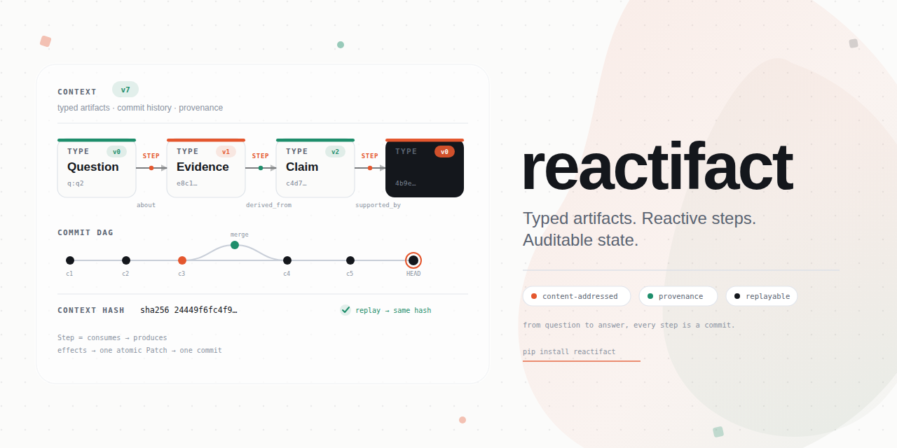
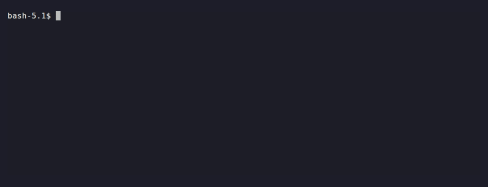

<p align="center">
  
</p>

**Agents that can prove their answers.** reactifact is a Python framework for
knowledge agents over docs, spreadsheets and the web — where the path per
question isn't a graph you can draw. The model reasons, plain Python computes
the numbers, and every answer links to the evidence behind it — then replays to
the same hash.

[](https://github.com/bzdvdn/reactifact/actions/workflows/ci.yml)
[](https://codecov.io/gh/bzdvdn/reactifact)
[](https://github.com/bzdvdn/reactifact)
[](https://pypi.org/project/reactifact/)
[](LICENSE)
[](https://deepwiki.com/bzdvdn/reactifact)
[](https://bzdvdn.github.io/reactifact/)

> **Is:** a Python library (3 core deps) · single-process · typed, versioned artifacts with provenance · deterministic replay · optional code-first knowledge base (SQLite/Qdrant) · runs offline, no API key
> **Isn't:** a managed platform · a distributed task queue · a pre-built agent/tool marketplace

## Sixty seconds, no API key

```bash
uvx reactifact demo        # or: uv add reactifact && uv run reactifact demo
```

```text
reactifact demo — computed, cited, reproducible

question What is the Q2 cloud spend variance, and does policy require approval?
sources  transactions.csv (6 rows) · budget.csv (2 rows) · policy.md

answer   Q2 cloud spend was $45,000 against a $40,000 budget (+12.5%) — exceeds
         the 10% policy threshold. CFO approval is required before the quarter
         is closed.

computed cloud spend $45,000 (2026-04 $12,000, 2026-05 $15,000, 2026-06 $18,000)
policy   threshold 10% → approval required
citations budget.csv, transactions.csv, policy.md

provenance (context.related(answer.id, "supported_by"))
  Answer    → supported_by → Variance, policy.md
  Variance  → calculated_from → Spend, budget.csv
  Spend     → calculated_from → transactions.csv

context sha256 ffeca1bb18cbc34749d3b5bdb40d85677b1ac33d47fb1160f6c89053694b2783
re-run         identical ✓
```

Three `@step` functions, none of which imports another by name: they declare
what they consume and produce, and the runtime derives the order from state.
The figures come from plain Python, and both the answer and the numbers carry
the hash of the exact state that produced them. Models, steps and the printer
all live in [`reactifact/demo.py`](reactifact/demo.py) — copy the pipeline,
then change the data.

## Define a step, run it

```python
from pydantic import BaseModel
from reactifact import Pipeline, step

class Question(BaseModel):
    text: str

class Answer(BaseModel):
    text: str

@step(consumes=Question)                 # produces=Answer inferred from ->
def answer(question: Question) -> Answer:
    return Answer(text=f"you asked: {question.text}")

pipeline = Pipeline(steps=[answer], seed_type=Question, answer_type=Answer)
result = pipeline.run(Question(text="why did cloud spend jump in Q2?"))

print(result.latest(Answer).data.text)
print(result.sources(result.latest(Answer)))   # citations, as a query
print(result.hash)                              # reproducible fingerprint
```

`Pipeline` owns steps, resources and defaults, and builds a fresh `Context` +
`Runtime` per run. Use `reactifact run` for the same thing from the CLI:

```bash
reactifact run app:pipeline "why did cloud spend jump in Q2?"
```

## Who this is for

- **Knowledge assistants over mixed sources.** One question spans Confluence, a
  spreadsheet and a web page; the next spans a different subset. You declare
  what artifacts exist and what agents can do with them, and the runtime derives
  the path. Figures are computed, answers cite their sources, and a run replays
  to the same hash.
- **Experiment harnesses for agent strategies.** Fork a context, run two
  strategies on their own branches, merge them back, and replay a finished run
  by hash — see [`forklab`](examples/forklab) and
  [Branching](docs/en/branching.md).

**RAG is included, not required.** `reactifact.quick.rag` gets retrieval with
provenance in a few lines; `reactifact.knowledge` is the code-first ingestion
layer behind it — connectors, chunking, incremental indexing, and real indexes
(SQLite, Chroma, Qdrant, pgvector). The core never imports either.

**Not for a fixed A → B → C pipeline.** There a plain function or LangGraph is
shorter and just as correct.

**Not a connector library.** If you need dozens of managed SaaS sources with
built-in ingestion, LlamaIndex is the better tool. reactifact's `Source` layer is
deliberately small and code-first: filesystem, CSV, embeddings, web, MCP.

## Start here

**Build an app**
```bash
uv init my-agent && cd my-agent
uv add reactifact                 # core + CLI; FastAPI stays optional
uv run reactifact new app my-app  # FastAPI: auth, sessions, SSE, traces
# or: uv run reactifact new daemon my-worker
```

The generated FastAPI project declares `reactifact[web]` itself; installing
`reactifact` alone never pulls FastAPI. The template and the code review
example are the best starting points; see [Examples](docs/en/examples.md).

**Use it in existing code**
```bash
uv add reactifact
uv run reactifact skills install   # teach your coding agent the mental model
```
Then start with `reactifact.quick` in [Quickstart](docs/en/quickstart.md), or
read [Concepts](docs/en/concepts.md) before designing artifacts.

**Inspect what a run actually did**
```bash
reactifact graph  my_app.agents
reactifact trace  traces.db
reactifact replay sessions.sqlite3
```

A question like *"why did infra costs jump in Q2?"* needs a spreadsheet, a policy doc and a page off the web — and the *next* question needs a different subset. That is not one graph you can draw up front. You declare what artifacts exist and what agents can do with them; the runtime derives the order — and the dependency graph — from state. You don't draw the graph.

Every derived artifact then links to what produced it
(`Answer —supported_by→ Evidence —extracted_from→ Doc`), so *"why did it say
that?"* is a query, not a guess — and the run is reproducible (`context_hash`)
and verifiable (`reactifact replay --verify`).

## The same idea, a real pipeline

[`examples/fintech_audit`](examples/fintech_audit) — a transactions CSV, a budget
CSV and a policy doc, **no API key**. The model never produces the number; plain
Python does, and the answer is linked to its evidence:

```text
$ .venv/bin/python -m examples.fintech_audit.main

  cloud spend:        $45,000   (2026-04 $12k, 2026-05 $15k, 2026-06 $18k)
  variance vs budget: +12.5%    budget $40,000, policy threshold 10% → over

  answer:    Q2 cloud spend was $45,000 against a $40,000 budget (+12.5%) —
             exceeds the 10% policy threshold. CFO approval is required.
  citations: budget.csv, transactions.csv, policy.md
  audit:     Answer —supported_by→ {Variance, Spend, Table, Policy}
             answer sha256 5461290d…  ·  context sha256 24449f6f…

  >>> re-running the pipeline hashes identically — or verify a saved run:
  >>> reactifact replay <store> --session <id> --verify 24449f6f…
```

That hash is the whole point: the answer is *reproducible* and its provenance is
a queryable graph (`context.related(answer.id, "supported_by")`), not a log line.



The number is computed, and its provenance recorded, in plain Python — the model
is never the source of truth (trimmed from
[`examples/fintech_audit/steps.py`](examples/fintech_audit/steps.py)):

```python
from reactifact import CALCULATED_FROM, Context, step

@step(consumes=Spend, provenance=CALCULATED_FROM)  # wakes when Spend exists
def compute_variance(spend: Spend, context: Context) -> Variance:
    budget = cloud_budget(context)                 # read from budget.csv
    pct = (spend.total - budget) / budget          # deterministic — never the model
    return Variance(actual=spend.total, budget=budget, pct=pct,
                    threshold=0.10, within_policy=abs(pct) <= 0.10)
    # creates the artifact and links it calculated_from→ Spend


result = Pipeline(steps=[compute_spend, compute_variance, answer]) \
    .run(Question(text="what is the Q2 cloud spend variance?"))
print(report_to_markdown(build_report(result.context, result.latest(AuditAnswer))))
print(result.hash)                                 # reproducible fingerprint
```

## Knowledge assistants, live

The same shape over many sources, not a fixed path — the
[`knowledge`](examples/knowledge) CLI answers a harder, multi-source question
(docs + a CSV) with a real computed number and its sources, no LLM key required:


Two agents explore independently on their own forks and merge back automatically
— and when they disagree, reactifact refuses to merge silently:


## Knowledge base: code-first ingestion

Agents need a corpus before they can reason over one. The optional
**`reactifact.knowledge`** layer turns documents into an index — as ordinary
Python objects, not YAML pipelines, a CLI or a plugin registry:

```python
from reactifact import RuntimeResources
from reactifact.knowledge import (
    KnowledgePipeline, ProviderEmbedder, SectionsChunker, SqliteIndex,
    llm_reranker,
)
from reactifact.providers import embedder_from_env, llm_from_env

resources = RuntimeResources(
    llm=llm_from_env(),          # chat: rerank (and answers)
    embedder=embedder_from_env(), # embeddings: index and query
)

pipeline = KnowledgePipeline(
    connector,                                     # source_id + async fetch()
    chunker=SectionsChunker(max_tokens=400, overlap=60),
    embedder=ProviderEmbedder(resources.embedder), # reuse the core provider
    index=SqliteIndex(".reactifact/knowledge.db"), # or QdrantIndex(...)
)

await pipeline.run(incremental=True)               # skips unchanged documents
hits = await pipeline.query(
    "how do I install it?",
    top_k=5,
    hybrid=True,
    rerank=llm_reranker(                           # optional: reorder/filter
        resources.llm,
        instructions="Prefer runbooks; ignore deprecated docs.",
    ),
)
```

It keeps the same boundaries as the rest of reactifact: `reactifact` never
imports it, it reuses the `EmbeddingProvider` on `RuntimeResources`, and
`IndexSource` / `IngestStep` are the only explicit bridges into `Source` /
`Step`. The layer ships `MemoryIndex`, `SqliteIndex`, `QdrantIndex`,
`PgVectorIndex` (`reactifact[pg]`) and an optional `ChromaIndex`
(`reactifact[knowledge-chroma]`), incremental `DocStore`
state, ACL-aware reconciliation, and BM25 + RRF hybrid
retrieval. No extra runtime dependencies; `FilesystemConnector` is the built-in
local-docs connector. `rerank=` is a query-time hook for
domain relevance policy (sync or async); `llm_reranker(resources.llm)` is an
optional helper that runs on the core chat provider and accepts custom
`system_prompt` / `instructions` / `user_prompt`.

```bash
# fully offline: SQLite index + deterministic embedder
uv run python examples/knowledge_base/build.py --docs docs/en --query "sources"
# switch to Qdrant with the same pipeline
uv run python examples/knowledge_base/build.py --docs docs/en --qdrant-url http://localhost:6333
```

See [Knowledge base](docs/en/knowledge.md) (or [по-русски](docs/ru/knowledge.md))
for connectors, indexes, incremental state and the bridge APIs. For ops, an
optional `reactifact.knowledge.web.create_knowledge_router` serves a read-only
`/knowledge` status page from the `DocStore` ledger — mounted separately from
the traces dashboard.

<details>
<summary><strong>If you know Celery…</strong> — the programming model, not its distributed runtime</summary>

Python developers already know this model from Celery: define a **task**,
declare what triggers it, let the runtime run it. reactifact applies it to
agents — a task reacts to a **typed, versioned artifact** appearing in the
context, not to a queue message you push or a graph edge you draw. The runtime
derives what runs next from state.

| Celery | reactifact |
| --- | --- |
| a task | `@step(consumes=Input) -> Model` — a unit of work that returns a typed artifact |
| `delay()` / `apply_async()` | you don't call it: creating the input artifact **is** the trigger |
| routing key / queue | `Consume(Type)` — which artifact type wakes the task |
| chain / group / chord | several step `Consume`s / `produces`; the runtime derives the order |
| result backend | the `Context` — typed, versioned artifacts |
| worker | `Runtime` |

**Not inherited:** a broker, a worker pool, `acks_late`/redelivery, cross-process
exactly-once. reactifact is a library with an in-process runtime — the *model* is
Celery-shaped, the deployment is not. (Session-backed runs do survive a restart;
see [Durability & resume](docs/en/durability.md).)

</details>

```bash
pip install reactifact
```

Runs offline, no API key needed — paste this straight into a `.py` file. Two
steps, no graph edge declared between them — the second reacts because the
first one's output exists, and the answer carries *proof* of where it came
from:

```python
from pydantic import BaseModel

from reactifact import Pipeline, SUPPORTED_BY, step


class Question(BaseModel):
    text: str


class Evidence(BaseModel):
    text: str


class Answer(BaseModel):
    text: str


DOCS = {
    "refund": "Refunds are available within 14 days of purchase.",
    "pricing": "The Pro plan is $49/month, billed annually.",
}


@step(consumes=Question)
def find_evidence(question: Question) -> list[Evidence]:
    hit = next((v for k, v in DOCS.items() if k in question.text.lower()), None)
    return [Evidence(text=hit)] if hit is not None else []


@step(consumes=Evidence, provenance=SUPPORTED_BY)
def answer_from_evidence(evidence: Evidence) -> Answer:
    return Answer(text=evidence.text)


result = Pipeline(
    steps=[find_evidence, answer_from_evidence],
    seed_type=Question,
    answer_type=Answer,
).run(Question(text="what's your refund policy?"))

answer = result.latest(Answer)
evidence = result.context.related(answer.id, SUPPORTED_BY)[0]
print(answer.data.text)                     # "Refunds are available within 14 days of purchase."
print("supported_by:", evidence.data.text)  # provenance you can trace, not just a string in a log
```

## How it works

```text
ARTIFACT CREATED / UPDATED
       │
       ▼
     STEPS REACT ──effects──► Effects ──compile──► Patch
       ▲                                                      │
       └──────────────────────────────────────────────────────┘
                                                        Context v+1
```

A step returns typed outputs (`-> Answer`, `tuple[...]`, `list[...]`) or a
change instruction (`Emit`, `Edit`, `Drop`, `Relate`); the runtime compiles
them into one **atomic** `Patch` and moves the context to the next version.
`effects` remains available for advanced/batch writes. The event that wakes a
step is *derived* from that same change — the causal chain can never drift from
the actual state.

## What makes it different

| Traditional agent (LangGraph / CrewAI / LangChain) | reactifact |
| --- | --- |
| A program follows a graph / plan | Agents **react** to state changes |
| Messages are strings | **Typed, versioned artifacts** (`Claim`, `Evidence`, `Answer`) |
| Orchestration is explicit wiring | Orchestration **falls out of the state** |
| A unit of work returns a change object | A step **returns typed artifacts**; the runtime compiles them |
| Retries/rollback are manual | Context is **git-like versioned** (diff, rollback, branch, merge) |
| "Who produced this?" is lost | **Provenance** links every derived artifact to its inputs |
| The model guesses the numbers | **Calculations are calculated** — the LLM is a reasoning component, not the source of truth |
| Tracing needs a SaaS add-on | **Native trace store** (SQLite + dashboard), exportable to Langfuse/Postgres |
| MCP via a framework adapter | **MCP both ways** built in — call any server, or expose your own `Context` as one |
| Pulls in a framework's dependency tree | **3 core deps**: `pydantic`, `httpx`, `python-dotenv` |

Reactive. Deterministic. Accountable.

Full breakdown, including where reactifact is *not* the right choice:
[docs/en/comparison.md](docs/en/comparison.md).

## Core primitives

- **Context** — versioned working state, git-like commits, `diff`/`rollback`/`merge`.
- **Artifact** — a first-class typed object (`Claim`, `Evidence`, `Answer`), not a string blob.
- **Effects** — the low-level write surface (`create/update/delete/link`); most steps return artifacts or `Edit`/`Drop`/`Relate` instead.
- **Patch** — the compiled, validated change-set applied as one atomic commit.
- **Step** — the unit of work: `@step(consumes=Question) -> Answer`; `produces` is inferred from the return type.
- **StepGroup** — an optional container when several steps share a trigger, retry, timeout or commit.
- **Source** — retrieval is a capability: vector search is *one* strategy, not the only one; filesystem, CSV, and the web are equally first-class today (direct API, keyword, and SQL sources are on the [roadmap](docs/roadmap.md#next), not yet shipped). For corpus ingestion, the optional `knowledge` layer adds connectors, chunking, embeddings and SQLite/Qdrant indexes.
- **Provenance** — every derived artifact links to what produced it
  (`Answer —supported_by→ Claim —derived_from→ Evidence —extracted_from→ Doc`).
- **HITL** — `human.ask(...)` → `PendingQuestion`, answered via `human.resume(...)`.
- **Outbox** — `outbox.act(...)` → `PendingAction`, performed once *after* the commit by `Runtime(dispatcher=...)`; safe across replay, retries and merged branches.

## In the box

- **Deterministic by design** — calculations over structured data, honest `None`
  fallbacks instead of hallucinated answers; the model reasons, never "knows".
- **Observability** — every run traces agent spans, reads/writes, LLM calls,
  tokens: SQLite store + web dashboard, exportable to Langfuse/Postgres (async sinks);
  **correlated logs** (`configure_logging()`, silent until called) carry
  `run_id`/`session_id`/`agent` on every line.
- **Lifecycle** — `Budget.max_seconds` is a hard deadline (a hung LLM call is
  cancelled); `request_stop()`/`ashutdown()` stop at a generation boundary
  (`RunOutcome.STOPPED`); `active_runs()`/`in_flight` give a readiness view.
- **MCP, both ways** — call any MCP server's tools as a `Tool`
  (`mcp_stdio_tools`/`mcp_http_tools`), or expose your own `Tool`s and a live
  `Context` as an MCP server (`create_mcp_server`) for Claude Desktop, Claude
  Code, or another agent to call into (`mcp` extra).
- **Budgets & replanning** — cap by runs/time/iterations/tool-calls, replan on decline.
- **Branching & replay** — `context.branch()`, three-way `merge()`, deterministic
  `ReplayLLM`, all for audit and safe alternative states.
- **Sessions** — `SessionStore` over `FileKVBackend`/`SQLiteKVBackend`
  (and `PostgreSQLKVBackend`) for durable chat memory.
- **Web layer** — `ChatAssistant` + `create_chat_router` mount a canonical SSE
  chat on *your* FastAPI app; errors degrade to a logged fallback, never a 500.
- **Recipes** — `find`/`find_all` (typed lookup in `inputs`), `fan_out_sources`,
  `materialize_doc`, `StatusMachine`, `WindowSummarizer`/`WindowPruner`
  (bounded conversation memory), change→rebuild rollback helpers,
  `Skill`/`match_skills` (Claude-Skills-shaped instructions, keyword-triggered)
  — pure and LLM-free, except the summarizer, which takes your callback.
- **Viz & CLI** — Mermaid `blueprint`/`context_to_mermaid`/`trace_to_mermaid`;
  `reactifact` with `graph`/`context`/`trace`/`replay`/`branch`.
- **Knowledge base (optional)** — code-first
  `Connector -> RawDocument -> Document -> Chunk -> Index`: incremental
  `DocStore`, ACL-aware reconcile, BM25 + RRF hybrid retrieval,
  `MemoryIndex`/`SqliteIndex`/`QdrantIndex`/`PgVectorIndex`, optional
  `ChromaIndex`; reuses core `EmbeddingProvider`s
  and exposes `IndexSource`/`IngestStep` bridges. No YAML, CLI or plugin
  registry (`pip install "reactifact[knowledge]"`).

## Agent Skills

reactifact ships official **Agent Skills** — reusable instructions that teach a
coding agent (Claude Code, Cursor, Codex, Copilot, …) how to build *with*
reactifact. They're bundled with the package, so they always match your version:

```bash
python -m reactifact skills list                    # what is available
python -m reactifact skills install                 # -> .agents/skills/
python -m reactifact skills install --target both    # + .claude/skills/
```

Skills: `reactifact` (mental model), `reactifact-agents`, `reactifact-llm`,
`reactifact-rag`, `reactifact-testing`, `reactifact-eval`,
`reactifact-observability`, `reactifact-from-langchain` — see
[Agent skills](docs/en/skills.md).

## Run a demo

Offline-capable, no API keys required (deterministic fallbacks):

```bash
uv run python ./examples/knowledge/web.py      # multi-source RAG + evidence + CSV calc
uv run python ./examples/repair/web.py         # room renovation: plan, estimate, CSV export
uv run python ./examples/devops/web.py         # HITL ops assistant + trace dashboard
uv run python -m examples.starter_app.app      # copy-pasteable FastAPI app
```

Prefer a notebook? [](https://colab.research.google.com/github/bzdvdn/reactifact/blob/master/examples/quickstart.ipynb)
— `examples/quickstart.ipynb` covers the four `quick` cases (`agent`/`rag`/`tools_agent`/`chat_agent`), offline by default.

## Examples (in-repo, not shipped)

- `starter_app` — copy-pasteable FastAPI app: structured call, RAG, tools, session chat.
- `knowledge` — multi-source chat: search → evidence → claim verification → answer, with CSV calculation.
- `knowledge_base` — real ingestion: connector → chunks → SQLite/Qdrant, incremental state, hybrid query.
- `medic_lab` — hypothesis laboratory: competing hypotheses scored, HITL steering, honest report.
- `devops` — HITL tool agents + LLM tool router + trace dashboard.
- `code_review` — deterministic-first diff review: rules + optional LLM findings → linked report.
- `repair` — budget-aware replanning (chat/data in Russian by design).
- `chat` — minimal offline single-model multi-turn conversation (`Conversation` + bounded `ChatMemory`).
- `forklab` — deterministic branch & merge: two strategies on their own forks, three-way merge.
- `fintech_audit` — auditable, reproducible CSV answer with content hashes and provenance.

## Documentation

- [English](docs/en/index.md) · [Русский](docs/ru/index.md) — concepts, sources,
  providers, recipes, patterns, observability, eval, branching, replay, viz/CLI, API.
- [Quickstart](docs/en/quickstart.md) — the four `quick` cases (structured call,
  RAG, tools, chat) in a few lines; also as a
  [Colab notebook](examples/quickstart.ipynb).
- [Migrating](docs/en/migrating.md) — from LangGraph / CrewAI / LlamaIndex /
  plain Python: concept map, port-one-node, interop, checklist.
- [Why reactifact](docs/en/why-reactifact.md) — the *design argument*: why effects, why the graph is derived rather than drawn, why determinism.
- [Knowledge base](docs/en/knowledge.md) — code-first ingestion/retrieval: connectors, incremental state, SQLite/Qdrant, hybrid search ([RU](docs/ru/knowledge.md)).
- [Comparison](docs/en/comparison.md) — reactifact vs LangGraph/CrewAI, feature by feature, and when *not* to use reactifact.
- [docs/constitution.md](docs/constitution.md) — the full design rationale and invariants.
- [Roadmap](docs/roadmap.md) — what's next, and what's deliberately out of scope.

## Development

```bash
uv sync --extra dev --extra web
.venv/bin/python -m pytest
.venv/bin/mypy
.venv/bin/ruff check
npx --yes pyright        # static check with the repo's pyproject config
```

## Status & contributing

Active, `0.22.0`, pre-1.0 — the API is stabilizing and `1.0` will freeze it
(see the [roadmap](docs/roadmap.md)); releases follow
[Keep a Changelog](CHANGELOG.md). Questions and design discussion live in
[GitHub Discussions](https://github.com/bzdvdn/reactifact/discussions); a star,
or a `good first issue`, helps more than you'd think.

## License

MIT — see [LICENSE](LICENSE).
