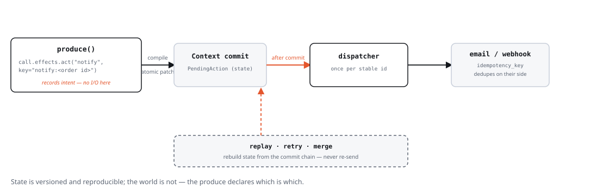

# Patterns

Reusable patterns observed across the examples. They are not abstract —
each is concretely instantiated in `examples/`.

## TL;DR

| Do | Don't | Why |
| --- | --- | --- |
| Write `effects.create/update/link/ask(...)`, return `None` | Assemble a `Patch` by hand in an ordinary produce | The runtime compiles one atomic patch per produce — building it yourself is the escape hatch, not the default |
| Guard eligibility with an early `return None` | Rely on scheduling order to skip work that isn't ready | Eligibility is a state decision, not a lucky accident (§69) |
| Use stable ids (`answer:{qid}`) or `effects.create_once(...)` | Re-derive an id from a counter or timestamp | Idempotent re-runs — the same event twice must not duplicate state |
| Return `None` on missing model / failed parse, then show an honest fallback | Substitute a canned "confident-sounding" answer when the LLM call fails | Deterministic work stays deterministic; generative failure must be visible, not papered over |
| Keep `next_status`/scoring functions pure `(state) -> ...` | Mix LLM calls or side effects into a `StatusMachine.next_status` | Pure functions are unit-testable without a runtime |
| Use `Runtime(isolate_errors=True, on_agent_error=...)` only when you've decided partial progress is acceptable | Reach for `isolate_errors` as a default to silence exceptions | Default is fail-loud (§69) — isolating errors is an explicit product decision, not a safety net |
| Record an outbound side effect with `effects.act(...)`, do the I/O in `Runtime(dispatcher=...)` | Send an email / call a webhook directly inside `run()` | The intent is committed state — replay, retries and merges cannot re-send it (§42) |

Each row links to the fuller pattern below.

## HITL: humans as first-class participants

A human is just another reaction to the context. The runtime represents a
question with `PendingQuestion`:

```python
class PendingQuestion(BaseModel):
    question: str
    kind: str = "general"          # e.g. "clarify", "approval"
    notes: dict[str, Any] = {}     # routing info ("which agent asked")
```

A step creates one with `effects.ask(...)`, and the human's answer
comes back through `effects.resume(...)` (an effect that marks the
`PendingQuestion` answered, §60):

```python
effects.ask("Approve the estimate?", kind="approval")
# ... the web/UI sees a pending question and shows a waiting state ...
effects.resume(question_artifact, "да")
return None
```

The producing agent sees the answer as a new event (the corresponding
`PendingQuestion` artifact is updated). Web demos query
`context.pending_questions()` to know whether to render a "waiting" state.

Pattern: **activate stage → immediately ask** (the repair `ApprovalStage`
creates the approval `PendingQuestion` the moment it becomes eligible, without
waiting for a user message), then **react to the answer** on the next event.

For a re-derivable question (`f"steer:{qid}:{round}"`, `medic-lab`'s steering
ask), pass `id=` to `effects.ask(...)` so a guard
(`if context.get(id) is not None: return None`) can stop the produce from
asking again while the question is still unanswered — the same idempotency
idiom as `effects.create_once`.

## Outbox: external side effects

A step should never perform external I/O itself — send an email, call a
webhook, deploy. It records the **intent** and the runtime performs it, once,
after the intent is committed:



```python
from reactifact import Artifact, Effects, PendingAction, Runtime, Step


class Notify(Step):
    consumes = (Order,)
    produces = (Receipt,)

    async def run(self, order: Artifact[Order], effects: Effects) -> None:
        # stable, content-derived key -> idempotent re-runs and merges
        effects.act(
            "notify",
            key=f"notify:{order.data.id}:email",
            payload={"to": order.data.email, "order": order.data.id},
        )
        effects.create(Receipt(order_id=order.data.id), id=f"receipt:{order.data.id}")


async def dispatch(context: Context, action: Artifact[PendingAction]) -> None:
    if action.data.kind == "notify":
        await send_email(action.data.payload, idempotency_key=action.data.idempotency_key)


runtime = Runtime(ctx, agents=[Notifier()], dispatcher=dispatch)
```

The runtime dispatches every committed-but-undispatched `PendingAction` after a
generation commits (and keeps the turn alive until the outbox is empty), marking
each `dispatched` — or `failed` (then re-raising) if the dispatcher throws. A
failing dispatcher must be idempotent on `action.data.idempotency_key`, because
resume is at-least-once ([durability](durability.md)).

Why it holds up:

- **Replay** reconstructs state without running the runtime, so it never
  re-sends; the `replay` CLI reports `dispatched / pending / failed` counts.
- **Retries** re-derive the same id, so `effects.act` returns `None` — no second
  intent. Two produces in one generation (snapshot isolation) both see nothing,
  but the outbox dedupes at drain.
- **Branches** that independently reach the same action share the id and merge
  to one intent; a `dispatched` side wins whichever branch is the merge target,
  so a merge never re-sends an already-sent action. Divergent payloads under one
  id raise `MergeConflict`.
- **Merge is pure state**: it never dispatches. Call
  `await runtime.flush_pending_actions()` after a merge if no new trigger will
  run.
- **Operations**: there is no background relay — the next `arun()` drains the
  outbox, and `flush_pending_actions()` drains it without a generation (call it
  on startup and periodically from your own timer). A failing dispatcher marks
  the action `failed` (bumping `attempts`), fires
  `Runtime(on_dispatch_error=...)`, and re-raises; `retry_action(id)` re-arms
  it. Backoff/retry policy belongs to the application or the dispatcher.

## Tool agents: LLM + tools (blocking or HITL)

For "the model decides which tool to call" flows, use the built-in agents:

```python
from reactifact import Consume, Step
from reactifact.llm_agent import HITLLMAgent

class OpsAgent(HITLLMAgent):
    name = "ops"
    system = "You run Kubernetes/GitLab/Ansible tasks."
    tools = [...]        # FunctionTool instances
    max_steps = 8
    max_asks = 2
    consumes = [Consume(Project)]
    steps = [Step(Report)]
```

- `LLMAgent` — blocking loop: the LLM emits `tool_call`, the runtime runs the
  tool, the observation feeds the next step. No human in the loop.
- `HITLLMAgent` — same, plus the LLM can emit `ask`: a `PendingQuestion` is
  created, the loop pauses, and the human's answer returns as
  `Observation(source="user")`. Tool *execution* itself is also gated by
  `ToolUseHITL`, so risky commands wait for a human click before running.

The `devops` example is the canonical `HITLLMAgent` demo (LLM tool router +
approval for K8s/GitLab/Ansible mutations).

### Deferred tool groups: many tools without the context cost

Connecting several MCP servers (or any large tool sets) means every one of
their schemas would otherwise land in the system prompt on every step, most
of them never called. `DeferredToolGroup` keeps a group's tools out of the
prompt — only its name, description, and bare tool names show up in a
compact catalog — until the LLM asks for it by calling the built-in
`load_tools` tool. `ToolUse`/`LLMAgent` support it; `ToolUseHITL`/
`HITLLMAgent` don't yet (see the class docstring for why):

```python
from reactifact.tools.use import DeferredToolGroup, ToolUse
from reactifact.mcp import mcp_stdio_tools

async def load_github_tools():
    async with mcp_stdio_tools("npx", ["-y", "@modelcontextprotocol/server-github"]) as tools:
        return tools

github_group = DeferredToolGroup(
    group_id="mcp:github",
    display_name="GitHub",
    description="Issues, PRs, repos, code search",
    tool_names=["create_issue", "search_repos", "create_pr"],
    loader=load_github_tools,
)

ToolUse(
    system="...",
    tools=[...],                       # always-visible tools
    deferred_tool_groups=[github_group],  # hidden until requested
)
```

`loader` runs at most once per group per `ToolUse` run — the group's real
tools (full schemas) join the regular tool list for the rest of that run
once loaded.

## Structured output: never parse raw JSON yourself

The runtime wraps a single LLM call into a `pydantic` schema with retries and
lenient JSON parsing:

```python
from reactifact.structured import StructuredLLM, structured_llm

# procedural variant:
body = await structured_llm(
    context, schema=AnswerBody,
    system="You assemble coherent answers.",
    user=f"Question: {question}\nFacts: {facts}",
)

# re-usable object variant:
_extractor = StructuredLLM(ProjectInfo, system="Extract repair facts; unknown = null")
facts = await _extractor.call(context, user=message_text)
```

Both return `None` on a missing model or a parse failure after retries — and the
caller is expected to handle `None` (see fallbacks). If you need to tell
"no provider configured" apart from "the provider is down" (e.g. to alert on
a real outage) without changing that `None` handling, pass `on_error`:

```python
def alert_if_down(reason: str, exc: Exception | None) -> None:
    if reason == "provider_error":
        logger.error("LLM outage: %r", exc)

body = await structured_llm(context, schema=AnswerBody, user=text, on_error=alert_if_down)
```

Build the `system`/`user` strings with `PromptTemplate` (core): declared
variables, a `KeyError` on missing vars, and model-attribute fields
(`template.render(topic=…, question=…)`) — no hand-rolled `.format` in app code.

`StructuredGenerateAgent` is the declarative wrapper: override
`build_prompt(inputs)`, optionally `fallback(inputs)`, declare `schema` — and
the reading/writing provenance is recorded for you.

## Plan-and-execute: draft once, run one step at a time

For a goal that decomposes into an ordered sequence of dependent steps, use the
`PlanExecute` recipe. The recipe owns ordering, gating, idempotent re-entry and
completion; your domain supplies three hooks:

```python
class Flow(PlanExecute[Goal, PlanStep, StepResult, FinalAnswer]):
    goal_type = Goal
    step_type = PlanStep
    result_type = StepResult
    final_type = FinalAnswer

    async def plan(self, context, goal): ...
    async def execute_step(self, context, step, history): ...
    async def finish(self, context, goal, results): ...


class FlowAgent(Agent):
    steps = Flow().produces()
```

`PlanExecute` runs exactly one step per generation and re-triggers itself from
the new `StepResult`; the last result triggers `finish`. See
`tests/test_recipe_plan_execute.py` for the runnable cases.

## Correlating across artifact types

`Consume.condition` only ever sees the single artifact matched by its own
type — it can't look at a *different* type's instance to decide whether to
fire. The real cases that need that ("a `Report` and its answered
`PendingQuestion` exist for the same thread", "no `HelpdeskTicket` has been
filed for this thread yet") used to get hand-rolled *inside* `run()`,
exactly the guard logic `consumes` exists to keep out of there.
`reactifact.consume.CorrelatedConsume` (and its two single-purpose factories)
puts that back where it belongs — on the class declaration:

```python
from reactifact.consume import AbsentConsume, JoinConsume

class ApprovalGate(Agent):
    consumes = [
        JoinConsume(
            Report, PendingQuestion,
            key=lambda d: d.thread_id,
            part_conditions={PendingQuestion: lambda d: d.answered},
        ),
    ]
    steps = [RecordApproval()]

class TicketGate(Agent):
    consumes = [
        AbsentConsume(Report, absent_type=HelpdeskTicket, key=lambda d: d.thread_id),
    ]
    steps = [FileTicket()]
```

`JoinConsume(*parts, key=...)` fires once every listed type exists for the
same key; `AbsentConsume(type, absent_type=..., key=...)` fires for `type`
only where no matching `absent_type` exists yet for the same key. Both are
thin factories over `CorrelatedConsume(require=..., forbid=...)` — reach for
`CorrelatedConsume` directly when a case needs *both* at once (required
present **and** forbidden absent), which neither factory alone can express
without nesting one inside the other. the step reads `inputs` the same
way it would read a mixed list from several ordinary `Consume`s — no
`isinstance`/scan guard needed inside the body.

## Selecting one of several triggers

Each step owns its consume contract, so an agent with several steps does not
need a global `reacts_to`: a step that consumes `ResolvedDocuments` simply does
not run for a `DecisionReply` event.

```python
class FinalizeWithDocuments(Step):
    consumes = (ResolvedDocuments,)
    produces = (DraftAnswer,)

    async def run(self, docs: Artifact[ResolvedDocuments]) -> DraftAnswer:
        return DraftAnswer(query_id=docs.data.query_id, source="documents")


class DirectFinalize(Step):
    consumes = (DecisionReply,)
    produces = (DraftAnswer,)

    async def run(self, reply: Artifact[DecisionReply]) -> DraftAnswer:
        return DraftAnswer(query_id=reply.data.query_id, source="direct")
```

For conditional selectors, use `Consume.by_field`/`by_status` or
`Annotated[T, When(...)]` on the step. The runtime skips the step entirely for
events outside its contract, so the body needs no type guard. A DELETED event on
the step's own consumed type is the one exception: `trigger` is `None` there
(the data is gone); use `call.event`/`event: Event` when reacting to deletions.

## Reacting to deletions

`Consume` listens to CREATED/UPDATED by default. A step that must react when an
artifact disappears includes the event type explicitly:

```python
from reactifact import Artifact, Consume, Context, Effects, Event, EventType, Step

class ResetPlan(Step):
    consumes = (
        Consume(PlanStep, event_types=(EventType.ARTIFACT_DELETED,)),
    )
    produces = (Project,)

    async def run(
        self,
        context: Context,
        event: Event,
        effects: Effects,
    ) -> None:
        assert context.get(event.artifact_id) is None
        project = context.latest(Project)
        if project is not None:
            effects.update(project, plan=[], stage="plan")
```

Two rules for deletion-reactive steps:

- There is **no trigger artifact** — the data is gone. Take `event: Event`
  (or `call.event`), not `Artifact[T]`; use `event.artifact_id` /
  `event.artifact_type`.
- The version store keeps history: `ctx.get(id)` is `None`, while
  `ctx.version_history(id)` / `find_versions(...)` still return prior versions.

Caveat: today `Context.delete()` emits only `ARTIFACT_DELETED` and does **not**
mark dependents `STALE` (unlike `update()`). If deleting an input should
invalidate derived artifacts, either handle it in an explicit
deletion-reactive step or mark those dependents stale yourself. Treat this as
the deletion contract until the core grows delete→stale invalidation.

## Reading input without waking up on it

`Consume(..., wakes=False)` still feeds `_collect_inputs()` but never
contributes to `Agent.triggers` — "read this as input, don't wake up on
it." The recurring case: an agent that should run when a `Question` arrives
but also wants `ConversationHistory` as input, without re-running once per
history artifact:

```python
consumes = [
    Consume(Question),
    Consume(ConversationHistory, wakes=False),
]
```

Before `wakes`, the only way to decouple "what wakes me" from "what I read"
was `Agent`'s separate `triggers=` override, kept in sync with `consumes` by
hand. `triggers=` is still the right tool for the *imperative* style (an
`Agent` subclass overriding `run()` directly, with no `consumes` at all) —
there's no `Consume` there to attach a condition to.

## Debouncing fan-out

A fan-out step that creates several artifacts of one type in a single commit
(five `Evidence` from one search step) fires one event per artifact. An
agent consuming that type by default runs once per event — five times for
one batch. `Consume(..., debounce=True)` collapses same-generation events
for that `Consume` into a single run:

```python
consumes = [Consume(Evidence, debounce=True)]
```

The single run reads `inputs` (collected fresh from `Context`), not
`event` — that's exactly the "which one changed" information debouncing
discards, so a debounced produce should never key off `event` for anything
beyond "something changed." Debouncing is scoped to the `Consume` it's set
on, not the whole agent: an agent with a mix of debounced and
non-debounced `Consume`s only collapses the debounced type's events. A
debounced run also correctly costs **one** against `Budget(max_runs=...)`,
not one per collapsed event.

## Fallbacks: honest degradation

Deterministic work stays deterministic; generative work degrades *honestly*:

1. If **no model is configured** — use the deterministic variant
   (canned options, fallback plans): demo mode without a key.
2. If a **model returns nothing usable** — do NOT substitute canned answers;
   report the failure openly: *"Не удалось подобрать варианты…"*.

The `repair` example implements both paths in `_make_design_options`:
`fallback_options` only when `context.resources.llm is None`, otherwise a
clear failure message.

## Cost/rollback model ("change → rebuild")

Long multi-stage conversations occasionally need to *go back*. The `repair`
example models this as: parse the change request → determine the earliest stage
affected → reset everything downstream deterministically:

```python
target = rollback_target(changed)      # "plan" | "estimate" | …
updates = _downstream_resets(target)   # clears design_options/plan/estimate
updates |= {"stage": target, "info": new_info, "handled_msg": ""}
```

Resetting `handled_msg` re-arms the stages so the rebuild actually runs. This
is the manual twin of `StatusMachine` — for those workflows where rollback is
part of the product, not a lifecycle.

## Budget and fairness

`Budget` caps a run:

```python
runtime = Runtime(ctx, agents=[...], budget=Budget(max_runs=200), max_concurrency=2)
```

- `max_runs`, `max_iterations`, `max_time_s`, tool-call caps — the runtime
  stops and reports `RunOutcome` (`completed` | `budget_exhausted` | …) with
  `RunStats`.
- `Agent.concurrency_limit` (LLM-bound agents default to a lower cap) + the
  runtime's global `max_concurrency` keep provider rate limits happy — the
  `medic-lab` demo runs a hypothesis laboratory with a LLM-limit of 2 inside a
  global cap of 6.
- By default one agent's exception propagates out of `arun()`/`astream()` and
  stops the whole run (§69 — fail loud, not silently). Opt into isolating it
  instead with `Runtime(isolate_errors=True, on_agent_error=...)`: that
  agent contributes no patch this generation, unrelated agents still make
  progress, and the failure is traced (`AgentSpan.error`) and counted
  (`RunStats.errors`) rather than hidden.

## Chat memory with sessions

State lives in the context, so *chat memory is just state*. Across requests:

```python
store = SessionStore(FileKVBackend("sessions"))
session = await store.open(session_id, resources=resources)
# ...create UserMsg, astream, await session.save()
```

`store.open` rehydrates the context from the last checkpoint; a background
agent (`@consume`/trigger) can trim history, update a `handled_msg` pointer, and
patch pending questions. The web demos ship this pattern verbatim.

## Status machines for long lifecycles

See [recipes](recipes.md). The rule of thumb for choosing between patterns:

| Situation | Approach |
| --- | --- |
| An artifact moves through phase states | `StatusMachine` + verify-produce |
| A workflow needs to roll *back* on user edits | stage guard + `_downstream_resets` |
| Explore & compare alternative states | `branch()` + `merge()` (§39-§40) |
| "Which of these did the model pick?" | `PickStage`-style parse + guard |

## Determinism as a habit

- The **produce contract**: write `effects.create/update/link/ask(...)` and
  return `None`; the runtime compiles the slot into one atomic patch (§24).
  `Patch` is the transport — you rarely type it in an ordinary produce.
- Make eligibility a guard, not a lucky scheduling accident (`return None` early).
- Prefer stable ids (`answer:{qid}`, `ref:{sid}:{owner}`) → idempotent re-runs.
  `effects.create_once(Model(...), id=...)` folds the "already done"
  guard into the call — `None` back means skip, don't rebuild the guard by
  hand above every `create`.
- Pure decision functions (`next_status`) are unit-testable without a runtime.
- Every LLM call has a structured schema, a retry budget, and a `None` path.