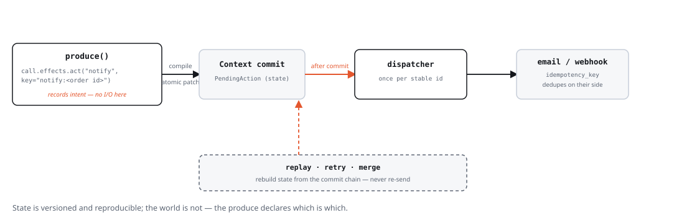

# Паттерны

Переиспользуемые паттерны, встречающиеся в примерах. Они не
абстрактны — каждый конкретно воплощён в `examples/`.

## TL;DR

| Делай | Не делай | Почему |
| --- | --- | --- |
| Пиши `effects.create/update/link/ask(...)`, возвращай `None` | Собирай `Patch` вручную в обычном produce | Runtime компилирует один атомарный патч на produce — ручная сборка это лазейка, а не дефолт |
| Оформляй допустимость через ранний `return None` | Полагайся на порядок планирования, чтобы пропустить неготовую работу | Допустимость — решение по состоянию, а не удачное стечение планирования (§69) |
| Используй стабильные id (`answer:{qid}`) или `effects.create_once(...)` | Выводи id из счётчика или таймстампа | Идемпотентные перезапуски — одно и то же событие дважды не должно дублировать состояние |
| Возвращай `None` при отсутствии модели / неудачном парсинге, показывай честный fallback | Подставляй «уверенно звучащий» канонический ответ при сбое LLM-вызова | Детерминированная работа остаётся детерминированной; сбой генерации должен быть виден, а не замаскирован |
| Держи `next_status`/скоринг чистыми функциями `(state) -> ...` | Подмешивай LLM-вызовы или побочные эффекты в `StatusMachine.next_status` | Чистые функции тестируются без runtime |
| Используй `Runtime(isolate_errors=True, on_agent_error=...)` только когда осознанно решил, что частичный прогресс приемлем | Ставь `isolate_errors` по умолчанию, чтобы заглушить исключения | По умолчанию — fail-loud (§69); изоляция ошибок — явное продуктовое решение, а не страховка |
| Записывай внешний side effect через `effects.act(...)`, а I/O делай в `Runtime(dispatcher=...)` | Отправляй письмо / дёргай webhook прямо в `produce()` | Намерение — закоммиченное состояние: replay, retry и merge не могут пере-отправить его (§42) |

Каждая строка ссылается на полный паттерн ниже.

## HITL: человек как полноправный участник

Человек — просто ещё одна реакция на контекст. Runtime представляет вопрос
артефактом `PendingQuestion`:

```python
class PendingQuestion(BaseModel):
    question: str
    kind: str = "general"          # например "clarify", "approval"
    notes: dict[str, Any] = {}     # маршрутизация ("какой агент спросил")
```

Шаг создаёт его через `effects.ask(...)`, а ответ человека приходит
через `effects.resume(...)` (эффект, помечающий `PendingQuestion` отвеченным,
§60):

```python
effects.ask("Утвердить смету?", kind="approval")
# ... web/UI видит ожидающий вопрос и показывает состояние «ожидание» ...
effects.resume(question_artifact, "да")
return None
```

Производящий агент видит ответ как новое событие (артефакт `PendingQuestion`
обновляется). Web-демо запрашивают `context.pending_questions()`, чтобы понять,
показывать ли состояние «ожидание».

Паттерн: **активировалась стадия → сразу спросить** (repair `ApprovalStage`
создаёт вопрос об одобрении в момент, когда становится активной, не дожидаясь
нового сообщения), затем **реагировать на ответ** следующим событием.

Для пересобираемого вопроса (`f"steer:{qid}:{round}"`, как в steering-вопросе
`medic-lab`) передайте `id=` в `effects.ask(...)`, чтобы гард
(`if context.get(id) is not None: return None`) не давал produce спрашивать
снова, пока вопрос ещё не отвечен — тот же идиом идемпотентности, что и у
`effects.create_once`.

## Outbox: внешние side effects

Шаг никогда не должен сам выполнять внешний I/O — отправлять письмо,
дёргать webhook, деплоить. Он записывает **намерение**, а runtime выполняет его
один раз после коммита намерения:



```python
from reactifact import Artifact, Effects, PendingAction, Runtime, Step


class Notify(Step):
    consumes = (Order,)
    produces = (Receipt,)

    async def run(self, order: Artifact[Order], effects: Effects) -> None:
        # стабильный ключ из содержания -> идемпотентные перезапуски и merge
        effects.act(
            "notify",
            key=f"notify:{order.data.id}:email",
            payload={"to": order.data.email, "order": order.data.id},
        )
        effects.create(Receipt(order_id=order.data.id), id=f"receipt:{order.data.id}")


async def dispatch(context: Context, action: Artifact[PendingAction]) -> None:
    if action.data.kind == "notify":
        await send_email(action.data.payload, idempotency_key=action.data.idempotency_key)


runtime = Runtime(ctx, agents=[Notifier()], dispatcher=dispatch)
```

Runtime дренирует каждый закоммиченный, но ещё не отправленный `PendingAction`
после коммита поколения (и держит ход живым, пока outbox не пуст), помечая
каждый `dispatched` — или `failed` (и пробрасывая исключение), если диспетчер
упал. Диспетчер должен быть идемпотентен по `action.data.idempotency_key`,
потому что возобновление — at-least-once ([durability](durability.md)).

Почему это надёжно:

- **Replay** реконструирует состояние, не запуская runtime, поэтому никогда не
  пере-отправляет; CLI `replay` печатает счётчики `dispatched / pending /
  failed`.
- **Retry** пересобирает тот же id, поэтому `effects.act` возвращает `None` —
  второго намерения нет. Два produce в одной генерации (snapshot isolation)
  оба не видят намерения, но outbox дедуплицирует на drain.
- **Ветки**, независимо пришедшие к одному действию, делят id и merge'атся в
  одно намерение; сторона со статусом `dispatched` побеждает, какой бы из
  веток ни была цель merge, поэтому merge никогда не пере-отправляет уже
  отправленное. Расходящаяся payload под одним id поднимает `MergeConflict`.
- **Merge — чистое состояние**: он никогда не диспатчит. Вызовите
  `await runtime.flush_pending_actions()` после merge, если новый триггер не
  запустит runtime.
- **Эксплуатация**: фонового relay нет — следующий `arun()` дренирует outbox, а
  `flush_pending_actions()` дренирует его без поколения (вызывайте на старте и
  периодически своим таймером). Падающий диспетчер помечает действие `failed`
  (увеличивая `attempts`), вызывает `Runtime(on_dispatch_error=...)` и
  пробрасывает исключение; `retry_action(id)` возвращает его в очередь.
  Backoff/retry-политика — на стороне приложения или диспетчера.

## Инструментальные агенты: LLM + инструменты (блокирующий или HITL)

Для потоков «модель решает, какой инструмент вызвать» используйте встроенных
агентов:

```python
from reactifact import Consume, Step
from reactifact.llm_agent import HITLLMAgent

class OpsAgent(HITLLMAgent):
    name = "ops"
    system = "You run Kubernetes/GitLab/Ansible tasks."
    tools = [...]        # экземпляры FunctionTool
    max_steps = 8
    max_asks = 2
    consumes = [Consume(Project)]
    steps = [Step(Report)]
```

- `LLMAgent` — блокирующий цикл: LLM отдаёт `tool_call`, runtime выполняет
  инструмент, наблюдение идёт в следующий шаг. Человека в цикле нет.
- `HITLLMAgent` — то же плюс модель может выдать `ask`: создаётся
  `PendingQuestion`, цикл останавливается, ответ человека возвращается как
  `Observation(source="user")`. Само *исполнение* инструмента также
  контролируется `ToolUseHITL`, поэтому рискованные команды ждут нажатия человека.

Пример `devops` — каноническая демонстрация `HITLLMAgent` (LLM-роутер инструментов +
одобрение мутаций K8s/GitLab/Ansible).

### Отложенные группы инструментов: много инструментов без нагрузки на контекст

Подключение нескольких MCP-серверов (или любого большого набора инструментов)
означает, что каждая схема иначе попадёт в system prompt на каждом шаге, хотя
большинство из них ни разу не вызовут. `DeferredToolGroup` держит инструменты
группы вне промпта — в компактном каталоге видны только имя, описание и
голые имена инструментов — пока LLM не запросит группу явно через встроенный
инструмент `load_tools`. `ToolUse`/`LLMAgent` это поддерживают; `ToolUseHITL`/
`HITLLMAgent` — пока нет (см. докстринг класса, почему):

```python
from reactifact.tools.use import DeferredToolGroup, ToolUse
from reactifact.mcp import mcp_stdio_tools

async def load_github_tools():
    async with mcp_stdio_tools("npx", ["-y", "@modelcontextprotocol/server-github"]) as tools:
        return tools

github_group = DeferredToolGroup(
    group_id="mcp:github",
    display_name="GitHub",
    description="Issues, PRs, repos, code search",
    tool_names=["create_issue", "search_repos", "create_pr"],
    loader=load_github_tools,
)

ToolUse(
    system="...",
    tools=[...],                          # всегда видимые инструменты
    deferred_tool_groups=[github_group],  # скрыты до запроса
)
```

`loader` выполняется не более одного раза на группу за один запуск `ToolUse`
— реальные инструменты группы (с полными схемами) присоединяются к обычному
списку инструментов на весь остаток этого запуска после загрузки.

## Структурный вывод: никогда не парсите сырой JSON сами

Runtime оборачивает один вызов LLM в схему `pydantic` с ретраями и терпимым
парсингом JSON:

```python
from reactifact.structured import StructuredLLM, structured_llm

# процедурный вариант:
body = await structured_llm(
    context, schema=AnswerBody,
    system="You assemble coherent answers.",
    user=f"Question: {question}\nFacts: {facts}",
)

# переиспользуемый объектный вариант:
_extractor = StructuredLLM(ProjectInfo, system="Extract repair facts; unknown = null")
facts = await _extractor.call(context, user=message_text)
```

Оба возвращают `None` при отсутствии модели или провале парсинга после ретраев —
и вызывающий обязан обработать `None` (см. фолбэки). Если нужно отличить
«провайдер не настроен» от «провайдер упал» (например, чтобы алертить на
реальный простой), не меняя саму обработку `None` — передайте `on_error`:

```python
def alert_if_down(reason: str, exc: Exception | None) -> None:
    if reason == "provider_error":
        logger.error("LLM outage: %r", exc)

body = await structured_llm(context, schema=AnswerBody, user=text, on_error=alert_if_down)
```

Строки `system`/`user` собирайте через `PromptTemplate` (ядро): объявленные
переменные, `KeyError` при нехватке, поля атрибутов модели
(`template.render(topic=…, question=…)`) — без ручного `.format` в коде приложения.

`StructuredGenerateAgent` — декларативная обёртка: переопределите
`build_prompt(inputs)`, опционально `fallback(inputs)`, объявите `schema` — чтение
и запись провенанса запишутся за вас.

## Plan-and-execute: план, затем шаг за шагом

Для цели, которая раскладывается в упорядоченную последовательность зависимых
шагов, используйте рецепт `PlanExecute`. Он владеет порядком, гейтингом,
идемпотентным повторным входом и завершением; домен поставляет три хука:

```python
class Flow(PlanExecute[Goal, PlanStep, StepResult, FinalAnswer]):
    goal_type = Goal
    step_type = PlanStep
    result_type = StepResult
    final_type = FinalAnswer

    async def plan(self, context, goal): ...
    async def execute_step(self, context, step, history): ...
    async def finish(self, context, goal, results): ...


class FlowAgent(Agent):
    steps = Flow().produces()
```

`PlanExecute` выполняет ровно один шаг за поколение и перезапускается от
нового `StepResult`; последний результат запускает `finish`. Рабочие кейсы —
`tests/test_recipe_plan_execute.py`.

## Корреляция между типами артефактов

`Consume.condition` видит только один артефакт своего же типа — заглянуть в
экземпляр *другого* типа, чтобы решить, срабатывать ли, он не может. Реальные
случаи, которым это нужно («существуют `Report` и отвеченный `PendingQuestion`
для одного треда», «для этого треда ещё не заведён `HelpdeskTicket`»), раньше
приходилось ручками зашивать *внутрь* `produce()` — ровно ту логику, которую
`consumes` и придуман убирать оттуда. `reactifact.consume.CorrelatedConsume`
(и две его фабрики под частные случаи) возвращает это на объявление класса:

```python
from reactifact.consume import AbsentConsume, JoinConsume

class ApprovalGate(Agent):
    consumes = [
        JoinConsume(
            Report, PendingQuestion,
            key=lambda d: d.thread_id,
            part_conditions={PendingQuestion: lambda d: d.answered},
        ),
    ]
    steps = [RecordApproval()]

class TicketGate(Agent):
    consumes = [
        AbsentConsume(Report, absent_type=HelpdeskTicket, key=lambda d: d.thread_id),
    ]
    steps = [FileTicket()]
```

`JoinConsume(*parts, key=...)` срабатывает, когда для одного ключа существуют
все перечисленные типы; `AbsentConsume(type, absent_type=..., key=...)`
срабатывает для `type`, только если для того же ключа ещё нет
`absent_type`. Обе — тонкие фабрики над `CorrelatedConsume(require=...,
forbid=...)` — берите `CorrelatedConsume` напрямую, когда нужно и то, и
другое сразу (требуемое присутствует **и** запрещённое отсутствует), что ни
одна из фабрик по отдельности не выразит без вложения одной в другую.
`produce()` читает `inputs` так же, как читал бы смешанный список от
нескольких обычных `Consume` — без `isinstance`-сканирования внутри тела.

## Выбор одного из нескольких триггеров

У каждого шага свой контракт `consumes`, поэтому агенту с несколькими шагами не
нужен глобальный `reacts_to`: шаг, потребляющий `ResolvedDocuments`, просто не
запускается на событие `DecisionReply`.

```python
class FinalizeWithDocuments(Step):
    consumes = (ResolvedDocuments,)
    produces = (DraftAnswer,)

    async def run(self, docs: Artifact[ResolvedDocuments]) -> DraftAnswer:
        return DraftAnswer(query_id=docs.data.query_id, source="documents")


class DirectFinalize(Step):
    consumes = (DecisionReply,)
    produces = (DraftAnswer,)

    async def run(self, reply: Artifact[DecisionReply]) -> DraftAnswer:
        return DraftAnswer(query_id=reply.data.query_id, source="direct")
```

Для условий используйте `Consume.by_field`/`by_status` или
`Annotated[T, When(...)]` на шаге. Runtime пропускает шаг для событий вне
контракта, поэтому тело не нуждается в type guard. Исключение — DELETED-событие
для потребляемого типа: `trigger` там `None` (данных уже нет); используйте
`call.event`/`event: Event`.

## Реакция на удаление

`Consume` по умолчанию слушает CREATED/UPDATED. Шаг, которому важно исчезновение
артефакта, явно включает тип события:

```python
from reactifact import Artifact, Consume, Context, Effects, Event, EventType, Step

class ResetPlan(Step):
    consumes = (
        Consume(PlanStep, event_types=(EventType.ARTIFACT_DELETED,)),
    )
    produces = (Project,)

    async def run(
        self,
        context: Context,
        event: Event,
        effects: Effects,
    ) -> None:
        assert context.get(event.artifact_id) is None
        project = context.latest(Project)
        if project is not None:
            effects.update(project, plan=[], stage="plan")
```

Два правила для deletion-reactive шагов:

- **Триггерного артефакта нет** — данных уже нет. Принимайте `event: Event`
  (или `call.event`), а не `Artifact[T]`; используйте `event.artifact_id` /
  `event.artifact_type`.
- Version store хранит историю: `ctx.get(id)` — `None`, а
  `ctx.version_history(id)` / `find_versions(...)` по-прежнему отдают прошлые
  версии.

Оговорка: сейчас `Context.delete()` эмитит только `ARTIFACT_DELETED` и **не**
помечает зависимые артефакты `STALE` (в отличие от `update()`). Если удаление
входа должно инвалидировать производные артефакты, либо обработайте это явным
deletion-reactive шагом, либо пометьте dependents stale сами. Считайте это
текущим контрактом удаления до появления delete→stale инвалидации в ядре.

## Чтение входа без пробуждения на нём

`Consume(..., wakes=False)` по-прежнему питает `_collect_inputs()`, но
никогда не попадает в `Agent.triggers` — «читай это как вход, но не буди
меня на этом». Повторяющийся случай: агент, который должен запускаться при
поступлении `Question`, но которому также нужна `ConversationHistory` как
вход — без перезапуска на каждый артефакт истории:

```python
consumes = [
    Consume(Question),
    Consume(ConversationHistory, wakes=False),
]
```

До `wakes` единственным способом отделить «что меня будит» от «что я читаю»
был отдельный оверрайд `triggers=` у `Agent`, который приходилось вручную
синхронизировать с `consumes`. `triggers=` по-прежнему нужен для
*императивного* стиля (подкласс `Agent`, переопределяющий `run()` напрямую,
вообще без `consumes`) — там просто нет `Consume`, к которому можно было бы
привязать условие.

## Дебаунс fan-out

Шаг fan-out, создающий несколько артефактов одного типа в одном коммите
(пять `Evidence` из одного шага поиска), порождает по одному событию на
каждый. Агент, подписанный на этот тип, по умолчанию запускается на каждое
событие — пять раз на один батч. `Consume(..., debounce=True)` схлопывает
события одного поколения для этого `Consume` в один запуск:

```python
consumes = [Consume(Evidence, debounce=True)]
```

Единственный запуск читает `inputs` (собранные заново из `Context`), а не
`event` — это как раз та информация «что именно изменилось», которую
дебаунс отбрасывает, так что дебаунсящий produce не должен опираться на
`event` ни для чего, кроме факта «что-то изменилось». Дебаунс завязан на
конкретный `Consume`, а не на весь агент: агент со смесью дебаунсящих и
обычных `Consume` схлопывает события только для дебаунсящего типа.
Схлопнутый запуск также корректно стоит **один** пункт бюджета
`Budget(max_runs=...)`, а не по одному на каждое схлопнутое событие.

## Фолбэки: честная деградация

Детерминированная работа остаётся детерминированной; генеративная деградирует
*честно*:

1. Если **модель не настроена** — используйте детерминированный вариант
   (заготовленные варианты, фолбэк-планы): демо-режим без ключа.
2. Если **модель вернула ничего полезного** — НЕ подменяйте канонные ответы;
   сообщите о сбое открыто: *«Не удалось подобрать варианты…»*.

Пример `repair` реализует оба пути в `_make_design_options`: `fallback_options`
только когда `context.resources.llm is None`, иначе — явное сообщение о сбое.

## Модель изменений и отката («изменить → пересобрать»)

Длинные многоэтапные диалоги иногда должны *откатываться*. Пример `repair`
моделирует это так: разобрать запрос на изменение → определить самую раннюю
затронутую стадию → детерминированно сбросить всё ниже по потоку:

```python
target = rollback_target(changed)      # "plan" | "estimate" | …
updates = _downstream_resets(target)   # чистит design_options/plan/estimate
updates |= {"stage": target, "info": new_info, "handled_msg": ""}
```

Сброс `handled_msg` переустанавливает стадии, чтобы пересборка реально
запустилась. Это ручной близнец `StatusMachine` — для потоков, где откат — часть
продукта, а не жизненного цикла.

## Бюджет и справедливость

`Budget` ограничивает запуск:

```python
runtime = Runtime(ctx, agents=[...], budget=Budget(max_runs=200), max_concurrency=2)
```

- `max_runs`, `max_iterations`, `max_time_s`, лимиты вызовов инструментов — runtime
  останавливается и сообщает `RunOutcome` (`completed` | `budget_exhausted` | …)
  вместе с `RunStats`.
- `Agent.concurrency_limit` (у LLM-агентов по умолчанию ниже) + глобальный
  `max_concurrency` runtime держат лимиты провайдеров: демо `medic-lab` — лаборатория
  гипотез с лимитом LLM = 2 внутри глобального лимита 6.
- По умолчанию исключение одного агента пробрасывается из `arun()`/`astream()`
  и останавливает весь запуск (§69 — падать громко, не молчать). Изолировать
  его можно через `Runtime(isolate_errors=True, on_agent_error=...)`: такой
  агент не даёт патча в этом поколении, остальные агенты всё равно
  продвигаются, а сбой трейсится (`AgentSpan.error`) и считается
  (`RunStats.errors`), а не прячется.

## Память чата через сессии

Состояние живёт в контексте, поэтому *память чата — это просто состояние*. Между
запросами:

```python
store = SessionStore(FileKVBackend("sessions"))
session = await store.open(session_id, resources=resources)
# ...создать UserMsg, astream, await session.save()
```

`store.open` восстанавливает контекст из последнего чекпоинта; фоновый агент
(`@consume`/триггер) может ужимать историю, обновлять указатель `handled_msg` и
закрывать зависшие вопросы. Web-демо несут этот паттерн дословно.

## Машины состояний для длинных жизненных циклов

См. [recipes](recipes.md). Правило выбора паттерна:

| Ситуация | Подход |
| --- | --- |
| Артефакт проходит фазовые состояния | `StatusMachine` + верификатор-produce |
| Потоку нужно *откатываться* на правках пользователя | гард стадии + `_downstream_resets` |
| Исследовать и сравнивать альтернативные состояния | `branch()` + `merge()` (§39-§40) |
| «Который из этих выбрала модель?» | парсинг как в `PickStage` + гард |

## Детерминизм как привычка

- **Контракт produce**: пишите `effects.create/update/link/ask(...)` и
  возвращайте `None`; рантайm компилирует слот в один атомарный патч (§24).
  `Patch` — транспорт, в обычном produce его почти не печатают.
- Право на запуск — гард, а не удачный порядок планировщика (`return None` рано).
- Предпочитайте стабильные id (`answer:{qid}`, `ref:{sid}:{owner}`) →
  идемпотентные повторы. `effects.create_once(Model(...), id=...)`
  сворачивает гард «уже сделано» прямо в вызов — `None` в ответ значит
  пропустить, а не собирать гард руками перед каждым `create`.
- Чистые функции решений (`next_status`) тестируются без runtime.
- У каждого LLM-вызова — структурная схема, бюджет ретраев и путь `None`.