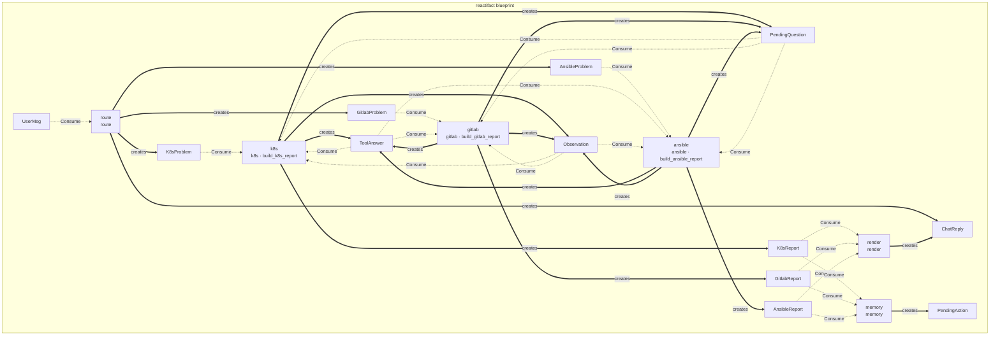

# devops — HITL tool agent (ops assistant)

An ops chat that routes a free-form complaint to a specialist agent (k8s /
GitLab / Ansible), each with its own tool and its own report builder. The
one domain twist: when an agent is mid-investigation and needs a value the
user never gave (a namespace, a project, a role), it asks — `human.ask(...)`
→ `PendingQuestion` — and the *next* user message resumes that question
instead of starting a new problem (`create_message` in `web.py`/`chat.py`
checks for a pending question first). `HITLLMAgent` + `ToolUseHITL` do the
reactive ask/resume loop; routing itself is a separate structured LLM step
(`StructuredLLM`), not folded into a specialist's own prompt.

## Structure

```
devops/
├── chat.py           # CLI entry (build_resources, terminal loop)
├── web.py            # FastAPI/SSE app + trace dashboard (create_trace_router)
├── models.py         # artifact types (UserMsg, *Problem, *Report) + tool results
├── policy.py         # demo identities + PermissionPolicy (pure)
├── resources.py      # per-user RuntimeResources (principal, memory, guardrails, clients)
├── agents/            # public agents: Route, K8s/Gitlab/Ansible, Render, Memory
│   ├── __init__.py    #   composition + PIPELINE
│   ├── router.py      #   UserMsg → the right *Problem
│   ├── reports.py     #   tool loop → *Report
│   ├── memory.py      #   *Report → PendingAction
│   └── reply.py       #   *Report → ChatReply
├── branches.py       # branch/merge prototype: 3 investigations, traces, conflict
├── tools.py           # typed @tool + fake K8s/GitLab/Ansible clients (DI, retry)
├── guardrails.py      # trust & safety: custom guardrails + the ops policy
├── safety.py          # runnable guardrail demo (no LLM/network)
├── online_eval.py     # online-eval: score served runs + the ops evaluators
├── prompts.py         # per-specialist system prompts
└── web/index.html     # UI
```

## Run

```bash
.venv/bin/python examples/devops/web.py      # SSE UI + trace dashboard on :8000
.venv/bin/python examples/devops/chat.py     # interactive CLI
.venv/bin/python examples/devops/safety.py   # guardrails demo (no LLM needed)
.venv/bin/python examples/devops/online_eval.py  # online-eval demo (no LLM needed)
```

Without an LLM key the tool router and specialists fall back to deterministic
demo behavior; with a key (in `.env`) routing and report generation go through
the configured provider — the tools themselves are always simulated (see
`tools.py`'s own docstring: no real Kubernetes/GitLab/Ansible is ever
touched, by design, so the demo is safe to run against nothing).

Try: `pods are crashlooping in prod` — routes to the k8s agent, which asks
for the namespace before calling `kubectl_get` (mandatory tool parameters
are exactly what forces the clarifying question, HITL `type:"ask"`).

## Tools: typed, injected, retried

`tools.py` is the smallest real-shaped tool layer in the repo. Each `@tool`
describes only the operation the model chooses; the API client is an injected
collaborator from `RuntimeResources`, so it never appears in the JSON schema:

```python
class K8sClient:
    async def get(self, resource: str, namespace: str) -> K8sSnapshot: ...


@tool(retry=RetryPolicy(max_attempts=2, backoff=0.1), timeout=10)
async def kubectl_get(
    resource: str, namespace: str, k8s: K8sClient
) -> K8sSnapshot:
    """Get the state of a k8s resource (pods, deployments, logs) in a namespace."""
    return await k8s.get(resource, namespace)


resources = register_clients(RuntimeResources(llm=llm))
```

- the model sees `resource`/`namespace`; `k8s` is resolved from resources;
- the tool returns a pydantic model → `ToolOutput.data` is structured JSON
  (the LLM still sees JSON text, the app can read fields without parsing);
- `retry=`/`timeout=` are the policy for a flaky real API;
- swapping the fake client for a real one is a one-line change in
  `register_clients` (the tool does not change);
- outside a runtime (`tests`, a script) call
  `execute_tool(kubectl_get, {...}, resources=resources)`.

One tool is deliberately destructive:

```python
@tool(destructive=True, timeout=10)
async def kubectl_restart(
    deployment: str, namespace: str, k8s: K8sClient
) -> RestartResult:
    """Restart a deployment (destructive: the human is asked to approve it)."""
    return await k8s.restart(deployment, namespace)
```

`HITLLMAgent` still offers it to the LLM, but a call pauses with a
`PendingQuestion(kind="approve")`; nothing is executed until the user answers
`yes`. Both entry points resume it (the web `create_message` and the CLI loop
handle `clarify` and `approve` alike). Try:

> restart api in production

The assistant asks for approval, then runs the tool and reports the result.

## Branches: parallel investigations, merged like features

`python -m examples.devops.branches` (offline, no API key) runs the same three
investigations two ways:

- **reactive fan-in** — one run; `Plan`, three investigation spans and
  `Compose` all appear in a single trace;
- **branch/merge** — `Plan` on the base, one branch per problem type, then a
  three-way merge and `Compose`. The reports are *different* artifact types, so
  the merge is conflict-free; a final `Compose` consumes all three and links
  the reply `supported_by` each report.

It also shows the failure mode on purpose: both branches edit the same
`Note` id, `merge` raises `MergeConflict` and applies nothing, then an explicit
policy (`policies={Note: ...}`) resolves it — the git-conflict shape, not a
silent last-write-wins.

Trace-wise the difference is visible: reactive fan-in is one run with five
spans; branch/merge is a planning run plus three child runs plus the compose
run. The prototype sets `trace_metadata={"branch": ..., "parent_run_id": ...}`;
those are now first-class `RunTrace.branch` / `RunTrace.parent_run_id` fields,
so `TraceStore` round-trips them and the demo prints the tree directly instead
of guessing from free-form metadata.

## How it flows — no graph to draw

Each agent declares what it `consumes`/`produces`; the runtime derives
execution from state changes.


The picture above walks the HITL ask/resume path through the `k8s` agent.
This is the actual static map of all 6 agents in this demo
(`python -m reactifact graph examples.devops.agents`):



Each specialist (`k8s`/`gitlab`/`ansible`) consumes its own `*Problem` type
*and* `ToolAnswer`/`Observation`/`PendingQuestion` — the self-consume that
lets `HITLLMAgent`'s reactive ask/resume loop keep running without the
specialist declaring that wiring itself (see `reactifact/llm_agent.py`).
`render` fans in every `*Report` type into one `ChatReply`; a mandatory tool
parameter that the router never captured is what forces the ask in the first
place, not a manual "if missing, ask" branch anywhere in this demo's own code.

## Multi-user: identity, authorization, memory

The demo ships two identities so the server-side boundaries are visible in the
UI: `admin1` (`admin` capability) and `admin2` (`analyst`). The CLI picks one
with `DEVOPS_USER=admin2`; the web UI sends the selected identity as `X-User`
and validates it in `request_factory` (unknown → `401`).

`X-User` is **demo authentication**, not proof of identity — a real deployment
resolves the principal from a verified session/JWT and maps roles to
capabilities. The authorization half is real: `policy.py` defines the
identities and the `PermissionPolicy`, `resources.py` builds a
`RuntimeResources(principal=…)` with them, and `route_problem` asks
`context.resources.authorize("run", target)` before it turns the message
into a problem. `admin2` has no `run:ansible` / `execute:ansible_run`, so an
Ansible request gets a normal "Access denied" `ChatReply` instead of starting
the agent (the tool gate remains the second line of defence).

Sessions are per-user by convention (`admin1:<uuid>`, stored under that key in
`localStorage`), and long-term memory is per-user by construction:

```python
resources = build_resources(llm, "admin1")   # MemoryStore(namespace="user:admin1")
ctx = Context(resources=resources)
ctx.create(UserMsg(text="проверь под", session_id="admin1:s1"))
await Runtime(ctx, agents=PIPELINE.agents, dispatcher=MemoryStore.dispatch).arun()
```

`MemoryStore` is **not** a copy of the chat. `remember_report` returns
`memory.remember_later(report, …)`: the step commits a `PendingAction` with a
short summary and its provenance, the runtime dispatches
it **after** the report commits, and `MemoryStore.dispatch` writes the index
entry. The session id is not ambient: the chat layer stamps it on `UserMsg`
(`create_message(ctx, text, session_id)`), the report keeps that message id in
`query_id`, and `remember_report` carries `source_session=msg.data.session_id`.
A failed turn therefore cannot leave a dangling memory entry. The report (and
the session/checkpoint) stay the source of truth. On a later question the
router searches report summaries and passes the hits to the routing prompt as
"Known context" — so a new session can recall "worker-2f1 OOMKilled in
production" without replaying the transcript. Because the namespace is
`user:<name>`, `admin2` never sees `admin1`'s memory, and
`forget_source(session_id)` can erase one session's derived entries
(GDPR-style).

The `/api/runs/{id}` read/delete endpoints are unauthenticated in this demo;
session ids are client-chosen. Treat them as a UI convenience, not an ACL.

## Trust & safety — custom guardrails

The ops assistant is a good place for guardrails: users ask for dangerous
things, and the artifacts that carry their request are typed, so a rule is
plain Python. `guardrails.py` defines a **custom** one — a destructive change
to production must cite a change ticket:

```python
from dataclasses import dataclass
from typing import Any
from reactifact import Context
from reactifact.guardrails import GuardrailDecision


@dataclass
class ProductionChangeGuardrail:
    name: str = "production_change"

    def check(self, data: Any, context: Context) -> GuardrailDecision:
        text = getattr(data, "text", "")
        if not (DESTRUCTIVE.search(text) and PROD.search(text)):
            return GuardrailDecision(guardrail=self.name)
        if TICKET.search(text):                       # approved change
            return GuardrailDecision(guardrail=self.name)
        return GuardrailDecision(                        # defer to the policy
            action="violation",
            reason="destructive change to production requires a CHG-… ticket",
            guardrail=self.name,
        )
```

A guardrail is just `name` + `check(data, context)`. Returning `violation`
defers the verdict to the policy (`on_violation="block"` raises
`GuardrailViolation`, `"flag"` records a metric and lets it through); returning
`redact` rewrites the data (see `SecretRedactionGuardrail`). The policy mixes
custom and built-in guardrails and is wired in one line — `chat.py` and
`web.py` both do this:

```python
resources = RuntimeResources(llm=llm, guardrails=devops_guardrail_policy())
```

Guardrails run on *produced* artifacts; `web.py`'s `create_message` screens the
raw input too (`screen(policy, ctx, text)`) so an unsafe request is refused
before routing. Run `python examples/devops/safety.py` to see all of it —
custom decision, redaction, an end-to-end block, and the flag metric — with no
LLM or network. The full reference is in
[docs/en/safety.md](../../docs/en/safety.md).

## Online evaluation

The trace dashboard stores every run, so the assistant can **score its own
traffic**. `online_eval.py` defines two trace-level evaluators (no `Context`
needed — a trace is truncated) and wires `reactifact.eval.online` to the same
store:

```python
def routed() -> Evaluator:            # produced a specialist problem or a reply
    def evaluate(eval_input: EvalInput) -> float:
        written = eval_input.outputs.get("artifacts", {})
        return 1.0 if set(written) & {"K8sProblem", "GitlabProblem",
                                      "AnsibleProblem", "ChatReply"} else 0.0
    evaluate.__name__ = "routed"
    return evaluate
```

`web.py` mounts `create_online_eval_router(build_evaluator(trace_store))`, so
`POST /api/evals/run` samples the latest runs, scores them and tags passes
`eval` / failures `eval:failed` — findable in the traces table next to the run.
For exact scoring (LLM judges over full text) pass `context_source(run_fn)`
instead of the default `trace_source()`; for sampling and cost, set
`sample_rate`/`limit` and wrap the provider in `CachingLLM`.

```bash
python examples/devops/online_eval.py          # offline demo, shows tags
reactifact eval examples/devops/traces.db      # score a real store from the CLI
```

## Trace dashboard

`web.py` mounts `create_trace_router` next to the chat router — every run's
agent spans, tool calls and LLM usage are inspectable at `/traces` without
any external service (see [docs/en/observability.md](../../docs/en/observability.md)).
